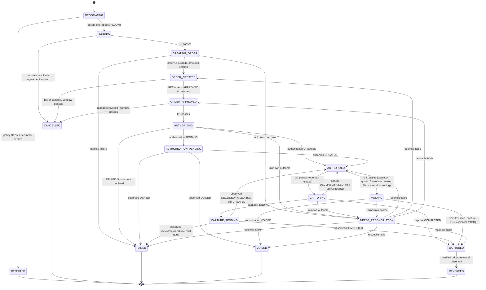

# PactPay Arena — Transaction State Machine

The state machine is a **pure, table-driven function** in `domain/transaction`: `transition(tx, event, ctx) → tx' | IllegalTransition`. It performs no I/O. The application layer persists the result, the audit event, and the attempt row in one DB transaction. Companion: [ARCHITECTURE.md](ARCHITECTURE.md) (models, gateway), [THREAT_MODEL.md](THREAT_MODEL.md).

**Implementation status:** the path AGREED → CREATING_ORDER → ORDER_CREATED → ORDER_APPROVED → AUTHORIZING → AUTHORIZED / AUTHORIZATION_PENDING / FAILED / NEEDS_RECONCILIATION is implemented, and so are AUTHORIZED → CAPTURING → CAPTURED / CAPTURE_PENDING and AUTHORIZED → VOIDING → VOIDED, with the reconcile table of §4.2 (`src/application/payments.ts`, tested against fakes, never against the real PayPal; see [PAYPAL_INTEGRATION.md](PAYPAL_INTEGRATION.md) §15 and §16). Verified webhooks are implemented as read triggers only (PAYPAL_INTEGRATION.md §17): they never move state by themselves, the fresh read does. The automatic honor-window void (T19) and `AUTHORIZED → VOIDED` for a lapsed hold are not implemented; a reconciliation that reads "no effect" is believed only after the 60 s in-flight timeout of §6.

PayPal status values below are from PayPal's official OpenAPI specs (read 2026-10-11): order `CREATED|SAVED|APPROVED|VOIDED|COMPLETED|PAYER_ACTION_REQUIRED`; authorization `CREATED|CAPTURED|DENIED|PARTIALLY_CAPTURED|VOIDED|PENDING` (no `EXPIRED`); capture `COMPLETED|DECLINED|PARTIALLY_REFUNDED|PENDING|REFUNDED|FAILED`. Anything marked **[A#]** is an unverified assumption listed in ARCHITECTURE §2.2.

## 1. States

| State                   | Meaning                                                                               | Money exposure counted against mandate |
| ----------------------- | ------------------------------------------------------------------------------------- | -------------------------------------- |
| `NEGOTIATING`           | Offers exchanged; no agreement                                                        | none                                   |
| `AGREED`                | Agreement frozen after policy `ALLOW`                                                 | **reserved**                           |
| `CREATING_ORDER`        | Create-order call in flight                                                           | reserved                               |
| `ORDER_CREATED`         | PayPal order exists, waiting for buyer approval at PayPal                             | reserved                               |
| `ORDER_APPROVED`        | Server GET confirmed order `APPROVED`, amounts match                                  | reserved                               |
| `AUTHORIZING`           | Authorize call in flight                                                              | reserved                               |
| `AUTHORIZATION_PENDING` | Authorization `PENDING` (e.g. `PENDING_REVIEW`)                                       | reserved                               |
| `AUTHORIZED`            | Authorization `CREATED`; funds **held, not charged**                                  | reserved                               |
| `CAPTURING`             | Capture call in flight                                                                | reserved                               |
| `CAPTURE_PENDING`       | Capture `PENDING` at PayPal — **not paid**                                            | reserved                               |
| `CAPTURED`              | Capture `COMPLETED` observed from PayPal                                              | **spent**                              |
| `VOIDING`               | Void call in flight                                                                   | reserved until `VOIDED`                |
| `VOIDED`                | Authorization `VOIDED` observed (terminal)                                            | released                               |
| `REJECTED`              | Policy deny / buyer or seller declined (terminal)                                     | released                               |
| `CANCELLED`             | Buyer abandoned, approval window passed, mandate revoked pre-authorization (terminal) | released                               |
| `FAILED`                | Definite failure, nothing charged (terminal)                                          | released                               |
| `NEEDS_RECONCILIATION`  | Outcome of an outbound call is unknown; carries `reconcilingFrom`                     | **reserved (conservative)**            |
| `REVERSED`              | A `CAPTURED` payment later observed refunded/reversed (terminal)                      | recorded, not re-spendable in MVP      |

Terminal: `VOIDED, REJECTED, CANCELLED, FAILED, REVERSED`. `CAPTURED` has exactly one outgoing edge (`REVERSED`). Exposure = sum of agreement totals for all rows not in a "released" state; the policy engine uses this so a `NEEDS_RECONCILIATION` transaction cannot be "double-spent" against the budget.

## 2. Transition table (authoritative)

An edge exists only if listed here. Anything else → `IllegalTransition` (state unchanged, `ILLEGAL_TRANSITION_ATTEMPT` audited, HTTP 409).

| #   | From                  | Event (who)                                                                                | Guard                                                                                                                                   | To                                                          | Side effects (same DB txn)                        |
| --- | --------------------- | ------------------------------------------------------------------------------------------ | --------------------------------------------------------------------------------------------------------------------------------------- | ----------------------------------------------------------- | ------------------------------------------------- |
| T1  | NEGOTIATING           | `accept_offer` (gateway, after recommendation or operator)                                 | **G-ACCEPT**                                                                                                                            | AGREED                                                      | create Agreement, PolicyDecision(ALLOW)           |
| T2  | NEGOTIATING           | `deny` / `reject` / `offer_expired`                                                        | –                                                                                                                                       | REJECTED                                                    | PolicyDecision(DENY) with reason codes            |
| T3  | AGREED                | `begin_create_order` (system)                                                              | **G0**                                                                                                                                  | CREATING_ORDER                                              | insert attempt `CREATE_ORDER` IN_FLIGHT           |
| T4  | AGREED                | `cancel` (operator) / `mandate_revoked` / `agreement_expired`                              | –                                                                                                                                       | CANCELLED                                                   |                                                   |
| T5  | CREATING_ORDER        | `order_created`                                                                            | order id present, status ∈ {CREATED, PAYER_ACTION_REQUIRED}, GET/response amount, currency, payee, `custom_id`, `invoice_id` equal ours | ORDER_CREATED                                               | attempt SUCCEEDED, store `orderId`                |
| T6  | CREATING_ORDER        | `definite_failure`                                                                         | classified (§4)                                                                                                                         | FAILED                                                      | attempt FAILED_DEFINITE                           |
| T7  | CREATING_ORDER        | `unknown_outcome`                                                                          | classified (§4)                                                                                                                         | NEEDS_RECONCILIATION (from=CREATING_ORDER)                  | attempt UNKNOWN                                   |
| T8  | ORDER_CREATED         | `buyer_approved_confirmed` (system, after return-URL hit **or** `CHECKOUT.ORDER.APPROVED`) | server `GET order`: status `APPROVED`, intent `AUTHORIZE`, exactly 1 purchase unit, all fields match                                    | ORDER_APPROVED                                              | `lastObservedPayPal` = GET                        |
| T9  | ORDER_CREATED         | `buyer_cancelled` / `approval_window_elapsed`                                              | window is local policy, not a PayPal fact **[A3]**                                                                                      | CANCELLED                                                   |                                                   |
| T10 | ORDER_APPROVED        | `begin_authorize` (system)                                                                 | **G1**                                                                                                                                  | AUTHORIZING                                                 | insert attempt `AUTHORIZE` IN_FLIGHT              |
| T11 | ORDER_APPROVED        | `mandate_revoked` / `approval_window_elapsed`                                              | –                                                                                                                                       | CANCELLED                                                   |                                                   |
| T12 | AUTHORIZING           | `authorized`                                                                               | authorization id, status `CREATED`, amount/currency == agreement                                                                        | AUTHORIZED                                                  | set `authorizedAt`, `honorExpiresAt` (§5)         |
| T13 | AUTHORIZING           | `authorization_pending`                                                                    | status `PENDING`                                                                                                                        | AUTHORIZATION_PENDING                                       |                                                   |
| T14 | AUTHORIZING           | `definite_failure`                                                                         | `DENIED`, 4xx incl. instrument declined                                                                                                 | FAILED                                                      |                                                   |
| T15 | AUTHORIZING           | `unknown_outcome`                                                                          | 5xx / timeout / **202** / **409** / unparseable / id mismatch                                                                           | NEEDS_RECONCILIATION (from=AUTHORIZING)                     |                                                   |
| T16 | AUTHORIZATION_PENDING | `observed_created` / `observed_denied` / `observed_voided`                                 | verified observation (§3)                                                                                                               | AUTHORIZED / FAILED / VOIDED                                |                                                   |
| T17 | AUTHORIZED            | `begin_capture` (operator release)                                                         | **G2**                                                                                                                                  | CAPTURING                                                   | insert attempt `CAPTURE` IN_FLIGHT                |
| T18 | AUTHORIZED            | `begin_void` (operator, system, or agent _request_ accepted by guard)                      | **G3**                                                                                                                                  | VOIDING                                                     | insert attempt `VOID` IN_FLIGHT                   |
| T19 | AUTHORIZED            | `honor_window_ending` (system timer)                                                       | `now ≥ honorExpiresAt − margin`                                                                                                         | VOIDING                                                     | auto-void; reason `HONOR_EXPIRING`                |
| T20 | CAPTURING             | `capture_completed`                                                                        | capture id, status `COMPLETED`, amount == agreement total                                                                               | CAPTURED                                                    | store `captureId`; **only** here is "Paid" shown  |
| T21 | CAPTURING             | `capture_pending`                                                                          | status `PENDING`                                                                                                                        | CAPTURE_PENDING                                             | store `captureId`, reason code                    |
| T22 | CAPTURING             | `capture_declined`                                                                         | status `DECLINED`/`FAILED` or definite 4xx; hold still `CREATED` (GET)                                                                  | AUTHORIZED                                                  | attempt FAILED_DEFINITE (retry budget §6)         |
| T23 | CAPTURING             | `unknown_outcome`                                                                          | 5xx / timeout / 202 / 409                                                                                                               | NEEDS_RECONCILIATION (from=CAPTURING)                       |                                                   |
| T24 | CAPTURE_PENDING       | `observed_completed`                                                                       | verified observation                                                                                                                    | CAPTURED                                                    |                                                   |
| T25 | CAPTURE_PENDING       | `observed_declined`                                                                        | verified observation                                                                                                                    | AUTHORIZED if hold `CREATED` & in honor window, else FAILED |                                                   |
| T26 | VOIDING               | `voided`                                                                                   | authorization status `VOIDED`                                                                                                           | VOIDED                                                      |                                                   |
| T27 | VOIDING               | `void_lost_race`                                                                           | 422/409 **and** GET shows capture `COMPLETED` (V4: cannot void a fully captured authorization)                                          | CAPTURED                                                    | audit `VOID_LOST_RACE`                            |
| T28 | VOIDING               | `unknown_outcome`                                                                          | 5xx / timeout / 202 / 409                                                                                                               | NEEDS_RECONCILIATION (from=VOIDING)                         |                                                   |
| T29 | NEEDS_RECONCILIATION  | `reconciled`                                                                               | per §4.2 table; observation must be verified (§3)                                                                                       | see table                                                   | `VerificationResult(PAYPAL_STATE_RECONCILIATION)` |
| T30 | CAPTURED              | `observed_refund_or_reversal`                                                              | verified observation (`PAYMENT.CAPTURE.REFUNDED/REVERSED` + GET)                                                                        | REVERSED                                                    |                                                   |

Operator "release" (T17) and "void" (T18) are the human-authority actions. An agent's `REQUEST_RELEASE` produces only a UI prompt; `REQUEST_VOID` may be accepted by the gateway because void can only reduce exposure — but it still must pass G3.

## 3. What counts as a "verified observation"

A state change that reflects PayPal-side truth may be driven only by:

1. **`API_RESPONSE`** — the 2xx body of _our own authenticated_ call, with returned ids/amounts matching expectations; or
2. **`API_GET`** — a server-side authenticated `GET` of the order / authorization / capture; or
3. **`VERIFIED_WEBHOOK`** — a webhook whose signature verification returned `VERIFIED` **and** that was then _confirmed by an `API_GET`_ of the referenced resource. The webhook is a trigger to look, not evidence by itself.

Never sufficient: LLM text, browser redirect/query parameters (`/api/paypal/return` only triggers a GET), unverified or `UNVERIFIABLE` webhooks, a locally computed hash.

## 4. Attempt outcome classification and reconciliation

### 4.1 Classifying an outbound call

| Result                                                           | Classification                                           | Rationale                                    |
| ---------------------------------------------------------------- | -------------------------------------------------------- | -------------------------------------------- |
| 2xx, parseable, ids/amount/currency/payee match expectations     | success → map PayPal status per table above              |                                              |
| 2xx but any mismatch (amount, currency, payee, id shape)         | **UNKNOWN** + `ANOMALY` audit; never auto-advance        | PayPal said "OK" but not about what we asked |
| 200/201 with `PENDING` status                                    | pending state (T13/T21), not success                     | V6                                           |
| 202                                                              | UNKNOWN                                                  | V4: accepted, not completed                  |
| 409                                                              | UNKNOWN                                                  | V4: prior call in progress / conflict        |
| 400, 403, 404, 422 (e.g. `INSTRUMENT_DECLINED`)                  | FAILED_DEFINITE                                          | request was processed and rejected           |
| 422 `ORDER_ALREADY_AUTHORIZED`                                   | UNKNOWN → reconcile (it means _an_ authorization exists) | the first attempt may have succeeded         |
| 401                                                              | refresh token once; retry once; then UNKNOWN             | transient credential state                   |
| 429, 5xx, timeout, connection reset, TLS error, unparseable body | **UNKNOWN**                                              | request may have been applied                |

### 4.2 Reconciliation (NEEDS_RECONCILIATION)

Procedure: `GET` the order (and authorization/capture ids if known) **[A3]** → apply table → write `VerificationResult(PAYPAL_STATE_RECONCILIATION)`. A retry re-sends with the **same `PayPal-Request-Id`** (V3) _only_ when the GET shows the action has not happened. Retention/replay semantics of the id are unverified **[A2]**, so the GET-first rule is mandatory.

| `reconcilingFrom` | Observed at PayPal                                                   | →                              | Notes                                                                                                             |
| ----------------- | -------------------------------------------------------------------- | ------------------------------ | ----------------------------------------------------------------------------------------------------------------- |
| CREATING_ORDER    | order id recoverable by replaying same request id → status `CREATED` | ORDER_CREATED                  |                                                                                                                   |
| CREATING_ORDER    | not recoverable after replay budget                                  | FAILED                         | No funds can move before buyer approval; orphan order is harmless                                                 |
| AUTHORIZING       | authorization `CREATED`                                              | AUTHORIZED                     |                                                                                                                   |
| AUTHORIZING       | authorization `PENDING`                                              | AUTHORIZATION_PENDING          |                                                                                                                   |
| AUTHORIZING       | authorization `DENIED`                                               | FAILED                         |                                                                                                                   |
| AUTHORIZING       | order `APPROVED`, no authorization                                   | ORDER_APPROVED (retry allowed) | goes back through G1                                                                                              |
| CAPTURING         | capture `COMPLETED`                                                  | CAPTURED                       |                                                                                                                   |
| CAPTURING         | capture `PENDING`                                                    | CAPTURE_PENDING                |                                                                                                                   |
| CAPTURING         | no capture; authorization `CREATED`                                  | AUTHORIZED (retry allowed)     |                                                                                                                   |
| CAPTURING         | authorization `VOIDED`                                               | FAILED                         | funds not captured                                                                                                |
| VOIDING           | authorization `VOIDED`                                               | VOIDED                         |                                                                                                                   |
| VOIDING           | capture `COMPLETED`                                                  | CAPTURED                       | void lost race                                                                                                    |
| VOIDING           | authorization `CREATED`, no capture                                  | AUTHORIZED (retry void)        |                                                                                                                   |
| any               | observation cannot be obtained (GET also fails)                      | **stay** NEEDS_RECONCILIATION  | backoff; after `N` tries raise `MANUAL_REVIEW` flag; **never** auto-success, never auto-failure that frees budget |

Crash recovery: on boot, every transaction in `CREATING_ORDER | AUTHORIZING | CAPTURING | VOIDING` with an `IN_FLIGHT` attempt older than `T_inflight` is moved to NEEDS_RECONCILIATION (attempt → UNKNOWN).

## 5. Guards — invariants that must hold _before_ each money action

All guards are evaluated **inside the same DB transaction** that performs the state CAS, using **server-held data and a fresh PayPal read**, never the request body or agent output. Failure → no PayPal call is made, `PolicyDecision(DENY, reasonCodes)` and `POLICY_DENIED` audit are persisted.

### G-ACCEPT (offer → agreement)

1. Offer `OPEN`, `now < validUntil`, not superseded.
2. Recompute `termsHash` from the stored structured fields; equals stored value.
3. Every line SKU exists in `seller_catalog` for that seller; unit price does not exceed the catalog price (the catalog price is a ceiling, so a negotiated discount is allowed and a mark-up is not; policy v1.1.0).
4. `serverTotal` recomputed (integer minor units, overflow-checked) **equals** `claimedTotal`; else `TOTAL_MISMATCH`.
5. `total.currency == mandate.perTransactionCap.currency` (USD).
6. Mandate `ACTIVE`, **latest** version for `mandate.id`, `now < expiresAt`.
7. Seller ∈ `mandate.allowedSellerIds`; `payeeRef` taken from catalog.
8. `total ≤ perTransactionCap`; `exposure + total ≤ totalBudget`.

### G0 — before CREATE_ORDER

1. Tx state is `AGREED`; CAS on `version`.
2. Re-run G-ACCEPT items 5–8 against the **current** mandate (revocation/new version since agreement ⇒ `DENY MANDATE_CHANGED`). Agreement's `mandateVersion` must equal the current active version, else a human must re-approve (new agreement).
3. Agreement `termsHash` equals the offer's recomputed hash (offer immutable → altered terms ⇒ `TERMS_HASH_MISMATCH`).
4. Request body is **built only from the Agreement**: `intent=AUTHORIZE`, single purchase unit, `amount = agreement.total` (decimal string from integer), `currency = USD`, `payee` = configured sandbox merchant matching `payeeRef` mapping, `custom_id = tx.id`, `invoice_id = <unique per tx>`. `requestHash` stored.
5. No non-`FAILED_DEFINITE` `CREATE_ORDER` attempt exists (DB partial unique index).

### G1 — before AUTHORIZE

1. Tx state `ORDER_APPROVED`, CAS.
2. Fresh `GET order`: `status=APPROVED`, `intent=AUTHORIZE`, one purchase unit, `amount.value`/`currency_code` equal agreement, payee merchant equals configured merchant, `custom_id == tx.id`, no existing `authorizations[]` (else reconcile, don't authorize again).
3. Mandate still `ACTIVE`, same version (else `CANCELLED`), unexpired; exposure unchanged-or-lower.
4. No live `AUTHORIZE` attempt (in flight / succeeded / unknown).

### G2 — before CAPTURE (the money-out gate)

1. Tx state `AUTHORIZED`, CAS; `captureId` unset; no `CAPTURE` attempt in `IN_FLIGHT | SUCCEEDED | UNKNOWN`.
2. **Release authority:** request origin is an authenticated operator session with CSRF token, or a pre-registered deterministic release rule (e.g. "buyer confirmed receipt"). Origin `AGENT` ⇒ `DENY RELEASE_REQUIRES_HUMAN`.
3. Fresh `GET authorization`: status `CREATED` (not `PENDING`, `PARTIALLY_CAPTURED`, `CAPTURED`, `VOIDED`, `DENIED`); authorization amount/currency equal agreement.
4. `now < honorExpiresAt − margin` (V1; reauthorization is out of MVP scope ⇒ otherwise `DENY HONOR_PERIOD_ENDED` and G3 void path).
5. Capture request built from Agreement: `amount == agreement.total`, `final_capture=true`, `invoice_id` per tx; captured-to-date is 0.
6. Mandate not `REVOKED`; per-tx cap and budget still satisfied (`total ≤ cap`, `exposure ≤ budget`).
7. Policy decision persisted with `inputsHash`; only then is `AuthorizedAction<"CAPTURE">` minted.

### G3 — before VOID

1. Tx state `AUTHORIZED` (or `NEEDS_RECONCILIATION` reconciling a void); CAS.
2. No `CAPTURE` attempt `SUCCEEDED` and `captureId` unset (V4: a fully captured authorization can't be voided).
3. Fresh `GET authorization` ∈ {`CREATED`, `PENDING`}; otherwise map via reconcile table instead of calling void.
4. Origin ∈ {operator, system rule (honor-window ending, mandate revoked, dispute flag), agent request that passed state checks}. Agent request cannot widen anything: void has no amount.
5. No live `VOID` attempt.

### Global invariants (checked by the `INVARIANT_SWEEP` verifier and property tests)

- I1 `captured ≤ authorized = agreement.total ≤ perTransactionCap` always.
- I2 `Σ exposure(all non-released transactions) ≤ mandate.totalBudget`.
- I3 Currency and payee of PayPal objects equal the agreement's, at every observation.
- I4 At most one successful `AUTHORIZE`, one `CAPTURE`, one `VOID` per transaction; `CAPTURE` and `VOID` never both succeed.
- I5 `version` increases by exactly 1 per transition; every transition has an audit event written in the same DB transaction.
- I6 `AuthorizedAction` exists ⇒ a persisted `ALLOW` decision with the same `transaction.version` and `mandateRef`.
- I7 `CAPTURED` ⇒ `captureId` set ∧ last observation `COMPLETED` from `API_RESPONSE|API_GET`.
- I8 Simulated provider ⇒ no PayPal ids, labels contain `SIMULATED`, never counted as paid.
- I9 Mandate rows and audit rows are never updated or deleted.

## 6. Time and retry rules

| Rule                           | Value (config)                                                                             | Note                                                                                                                         |
| ------------------------------ | ------------------------------------------------------------------------------------------ | ---------------------------------------------------------------------------------------------------------------------------- |
| Honor period                   | 3 days from authorization (V1)                                                             | `honorExpiresAt = min(PayPal create_time [A3], our observed time) + 3d`; local clock — `EXPIRED` is not a PayPal status (V2) |
| Safety margin before honor end | 1 h                                                                                        | auto-void (T19)                                                                                                              |
| Order approval window          | 2 h local policy                                                                           | not a PayPal fact; avoids stale mandates                                                                                     |
| Attempts per action            | ≤ 3, partial unique index: at most one attempt per `(tx, action)` not in `FAILED_DEFINITE` | `requestId = pp:{tx}:{action}:{seq}`; retry of the _same_ attempt reuses the same id                                         |
| Reconcile backoff              | 5s, 30s, 5m, 30m …                                                                         | then `MANUAL_REVIEW`                                                                                                         |
| In-flight timeout              | 60 s                                                                                       | then crash-recovery path                                                                                                     |

Time is injected (`Clock` port); tests drive it. **Honor-period expiry is verified only against our injected clock, not against PayPal [A6].**

## 7. Duplicate, replay, concurrent requests

- Every transition is a compare-and-swap: `UPDATE transactions SET state=?, version=version+1 WHERE id=? AND state=? AND version=?`. Zero rows ⇒ HTTP 409 with the current state. A double-clicked "Release" lands in `CAPTURING` once; the second request sees `CAPTURING` and is rejected.
- Inbound `Idempotency-Key` + request hash in `request_dedup`: same key & same body ⇒ replay the stored response; same key & different body ⇒ 422.
- Outbound: stable `PayPal-Request-Id` per attempt + local unique index; the local guard is primary because PayPal's retention/replay semantics are not fully documented [A2].
- Webhook duplicates: `UNIQUE(paypal_event_id)`; a second delivery returns 200 and does nothing.
- Replayed old webhook (valid signature, stale `create_time`): its effect is computed from the fresh `GET`, so a stale event cannot regress state; transitions are monotonic by table.
- Out-of-order events (e.g. `CAPTURE.COMPLETED` before our response is stored): the `GET` shows truth; T24/reconcile table handle it.

## 8. Test obligations (mapped in ACCEPTANCE_CRITERIA)

Table-driven test generated from §2: every (state × event) pair not listed ⇒ `IllegalTransition`. Property tests for G-ACCEPT arithmetic. Fault-injection tests on the provider for each row of §4.1/§4.2. Concurrency test: N parallel `release` calls ⇒ exactly one provider call.
